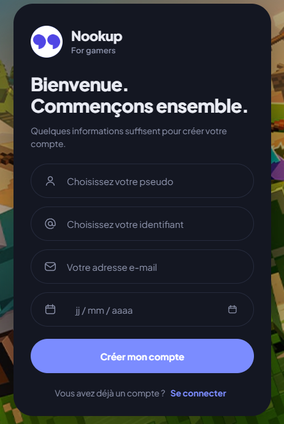
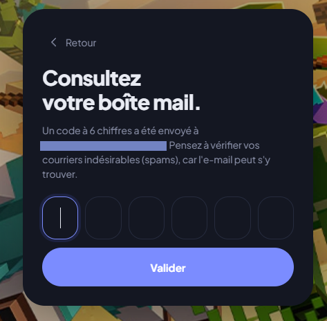
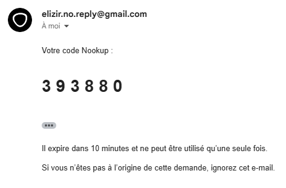
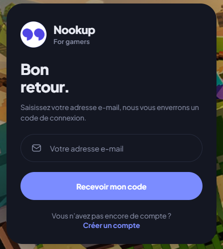
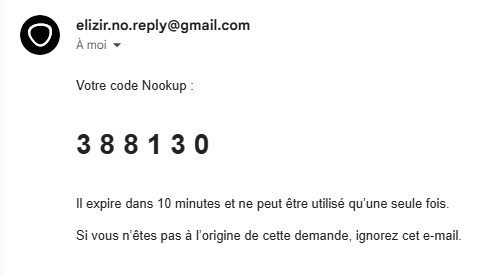

# Créer un compte | Se connecter 💻

Bienvenue sur **[nookup.me](https://nookup.me)** ! Dans cet article de la documentation officielle, vous apprendrez à **créer un compte** et **s'y connecter**.

La création de compte est **totallement gratuite**, vous pouvez en créer un quand vous voulez !

## ✏️ Créez un Compte

Comment mentionner **ci-dessus**, votre inscription à nookup reste totallement gratuite.

### 🔷 1. Accédez au site

Pour créer votre compte, rendez-vous sur le **[site officiel de nookup](https://nookup.me)**.

**Vous allez arriver sur cette interface :**

### 🔷 2. Créez votre compte

Une fois arriver à ce menu, cliquez sur **Créer un compte** (tout en bas). Vous pourrez alors entrer les informations suivantes :

- **Pseudo** : Choisissez un nom d'affichage pour votre compte. Quand vous discuterez avec les autres utilisateurs, ils verront votre pseudo.

- **Identifiant** : Entrez un indentifiant unique pour votre compte. Même si un autre utilisateur copie votre pseudo, vos identifiants seront toujours différents.

- **Adresse E-Mail** : Entrez votre adresse e-mail. Elle permettera de confirmé que vous n'êtes pas un bot et c'est le **seul** moyen pour vous de vous connecter à votre compte (aucun mot de passe n'est requis). Vous pourrez aussi recevoir des mails de la part de nookup pour chaques offres ou réductions temporaires. (option a activé).

_Pour finir, cochez la case **"Je confirme avoir au moins 15"**._

### 🔷 2. Confirmez la création

Cliquez sur **Créer mon compte** pour créer votre compte nookup ! Mais attention, ce n'est pas fini.

Nous devons encore confirmer que n'êtes pas un **robot**, pour cela nous allons vous envoyer un code à **6 chiffres** à votre adresse e-mail.

_Screen depuis [nookup](https://nookup.me)._

_Screen depuis [gmail](https://mail.google.com/)._

Il vous suffit ensuite d'entrer votre code dans le champ prévu pour et vous voilà sur **nookup** avec votre nouveau compte !

## 🌐 Se Connecter

### 🔷 1. Accédez au site

Pour vous connecter à votre compte, rendez-vous sur le **[site officiel de nookup](https://nookup.me)**.

**Vous allez arriver sur cette interface :**

Saissez votre **adresse e-mail** (choisi lors de la création de votre compte) et cliquez sur **"Recevoir mon code"**.

Vous obtiendrez alors un code à **6 chiffres** dans votre boîte mail.

_Screen depuis [gmail](https://mail.google.com/)._

Il vous suffit ensuite d'entrer votre code dans le champ prévu pour et vous voilà de retour sur nookup !

**🚀 N'hésitez pas à nous donner votre avis sur cet article.**